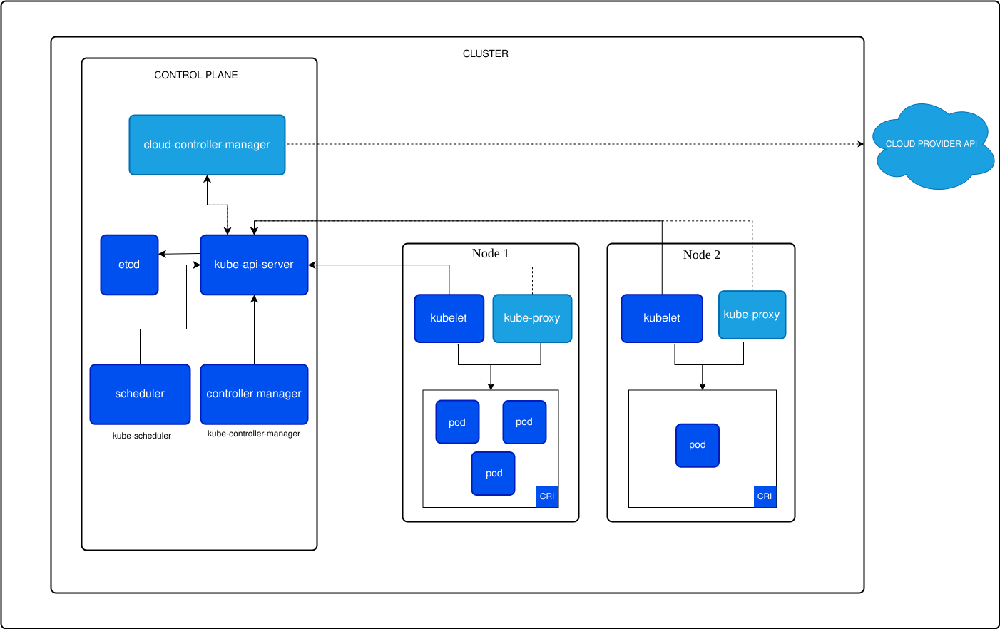

# Kubernetes Architecture

## 1. What is Kubernetes?

Kubernetes (K8s) is an open-source container orchestration platform used to deploy, manage, scale, and maintain containerized applications across a cluster of machines.

It provides capabilities such as:

- Container orchestration
- Automated scheduling
- Service discovery and load balancing
- Self-healing
- Horizontal scaling
- Configuration and Secret management
- Storage orchestration
- Rolling updates and rollbacks

**Core idea:** Kubernetes manages the desired state of an application and continuously works to make the actual cluster state match it.

---

## 2. Kubernetes Cluster Architecture

A Kubernetes cluster consists of two major parts:

1. Control Plane
2. Worker Nodes

### Control Plane

The Control Plane manages the cluster. It makes cluster-wide decisions, maintains the desired state, and coordinates workloads.

Main components:

- kube-apiserver
- etcd
- kube-scheduler
- kube-controller-manager
- cloud-controller-manager (optional)

### Worker Nodes

Worker Nodes provide the environment in which application workloads run.

Main components:

- kubelet
- Container Runtime
- kube-proxy (optional)
- Pods

### Architecture overview



A production cluster may have multiple Control Plane instances and multiple Worker Nodes for availability and scalability.

A local kind cluster can run the Control Plane and application workloads on the same Kubernetes node.

---

# 3. Control Plane Components

## 3.1 kube-apiserver

The API Server is the central entry point to the Kubernetes API.

It acts as the communication hub through which Kubernetes components interact with cluster state.

### Responsibilities

- Exposes the Kubernetes HTTP API.
- Receives requests from kubectl, controllers, and other components.
- Authenticates API requests.
- Authorizes API requests.
- Runs admission control.
- Validates and processes API objects.
- Reads and writes persistent cluster data in etcd.
- Provides List and Watch APIs to other components.

### Important architectural detail

The API Server is the only standard Kubernetes control-plane component that directly reads from and writes to etcd.

Other Kubernetes components interact with cluster state through the API Server.

### Example

```bash
kubectl get pods
```

Simplified communication:

```text
kubectl
   |
   v
API Server
   |
   v
Retrieve Pod information
   |
   v
Response to kubectl
```

### Admission Controllers

Admission control is part of the API request-processing pipeline.

After authentication and authorization, admission controllers can modify or reject requests before accepted objects are persisted.

Two main categories:

| Type | Responsibility |
|---|---|
| Mutating | Modifies an incoming object |
| Validating | Checks whether an object satisfies policies and can reject it |

Examples:

- LimitRanger: Enforces namespace resource constraints and can apply default resource values.
- ResourceQuota: Enforces resource quotas within a namespace.
- PodSecurity: Enforces Pod Security Standards.
- Mutating Admission Webhook: Can modify an object through an external webhook.
- Validating Admission Webhook: Can validate or reject an object through an external webhook.

Simplified request flow:

```text
Client Request
      |
      v
API Server
      |
      v
Authentication
      |
      v
Authorization
      |
      v
Mutating Admission
      |
      v
Object Validation
      |
      v
Validating Admission
      |
      v
Persist accepted object
in etcd
```

This is a simplified learning-level sequence, not a complete description of every internal API processing stage.

---

## 3.2 etcd

etcd is a distributed, consistent key-value store used as the backing store for Kubernetes cluster data.

Think of it as the persistent storage layer for cluster state.

### What does it store?

Examples include:

- Pods
- Deployments
- Services
- ConfigMaps
- Secrets
- Nodes
- Other Kubernetes API objects and cluster configuration

### Example

Suppose we create a Deployment:

```yaml
apiVersion: apps/v1
kind: Deployment
metadata:
  name: backend
spec:
  replicas: 3
```

The accepted Deployment object is persisted as cluster state.

### Important points

- etcd stores cluster data; it does not run containers.
- The API Server handles normal Kubernetes access to etcd.
- etcd supports consistency and availability through distributed consensus.
- Production clusters require a reliable etcd backup and recovery strategy.

**Remember:** API Server manages access to cluster state; etcd persists that state.

---

## 3.3 kube-scheduler

The Scheduler decides which Worker Node should run an unscheduled Pod.

It does not start containers.

### How does it work?

The Scheduler watches the API Server for Pods that have not yet been assigned to a node.

It evaluates suitable nodes based on scheduling requirements, such as:

- CPU and memory requests
- Node availability
- Node selectors
- Node affinity and anti-affinity
- Taints and tolerations
- Scheduling constraints

It selects a suitable node and communicates the assignment through the API Server.

### Example

```text
Pod requires:
CPU:    500m
Memory: 512Mi

Available Nodes:

Node A: Suitable
Node B: Suitable
Node C: Insufficient resources

Scheduler selects a suitable node.
```

### Important distinction

| Component | Responsibility |
|---|---|
| Scheduler | Selects a node for the Pod |
| kubelet | Ensures the assigned Pod runs |
| Container Runtime | Executes the containers |

---

## 3.4 kube-controller-manager

The Controller Manager runs Kubernetes controllers.

A controller continuously works to reconcile the actual state of the cluster with the desired state.

### Desired State vs Actual State

Suppose we create a Deployment requesting three replicas.

```yaml
spec:
  replicas: 3
```

Initially:

```text
Desired Pods: 3
Actual Pods:  3
```

Now one Pod is deleted:

```text
Desired Pods: 3
Actual Pods:  2
```

The ReplicaSet controller detects the difference and works to create a replacement Pod.

```text
Desired State: 3
Actual State:  2
       |
       v
Controller detects difference
       |
       v
Creates replacement Pod
       |
       v
Desired State: 3
Actual State:  3
```

### How do controllers detect changes?

Controllers commonly use the Kubernetes List and Watch APIs through Informers.

Simplified flow:

```text
API Server
    |
    | List + Watch
    v
Informer
    |
    v
Local Cache
    |
    v
Event Handler
    |
    v
Controller Work Queue
    |
    v
Reconciliation
    |
    v
API Server
```

1. Informer obtains initial object information using List.
2. It watches for changes through the API Server.
3. It maintains a local cache of observed objects.
4. Event handlers notify controllers about relevant changes.
5. Controllers reconcile desired and actual state.
6. Controllers make necessary changes through the API Server.

**Important:** Controllers are not simply polling the API Server every few seconds. Watch events drive normal change detection, although retries and periodic resynchronization can also occur.

### Examples of controllers

- Node Controller
- Deployment Controller
- ReplicaSet Controller
- Job Controller
- EndpointSlice Controller
- ServiceAccount Controller

**Remember:** Controllers implement the reconciliation model that gives Kubernetes much of its self-healing behavior.

---

## 3.5 cloud-controller-manager

The Cloud Controller Manager integrates Kubernetes with cloud-provider-specific infrastructure.

It is optional and generally relevant to cloud-managed environments.

### Responsibilities

- Cloud node information
- Cloud networking routes
- Cloud load balancers
- Integration with cloud infrastructure

### Example

When a supported cloud cluster creates a Service of type LoadBalancer, the cloud provider integration can provision an external load balancer.

---

# 4. Worker Node Components

A Worker Node is a physical or virtual machine that provides resources for running Pods.

## 4.1 kubelet

kubelet is an agent that runs on every Kubernetes node.

Its responsibility is to ensure that the Pods assigned to its node are running according to their specifications.

### Responsibilities

- Watches the API Server for Pods assigned to its node.
- Ensures the required containers are running.
- Monitors container and Pod health.
- Reports node and Pod status.
- Communicates with the container runtime through CRI.
- Renews the node Lease to report node health.

### Important distinction

kubelet does not manage arbitrary containers that were not created by Kubernetes.

### Node Heartbeats and Lease Objects

Kubernetes uses Lease objects to track node health.

- Each node has a Lease in the kube-node-lease namespace.
- kubelet periodically renews its Lease.
- The default renewal interval is 10 seconds.
- The Lease renewal time helps the control plane determine whether a node is healthy and reachable.
- The Node Controller monitors node health and responds when a node becomes unreachable.

NodeStatus updates also exist. Leases provide a lightweight heartbeat mechanism.

---

## 4.2 Container Runtime

The Container Runtime is responsible for actually running containers.

Examples:

- containerd
- CRI-O

Kubernetes communicates with the runtime through the Container Runtime Interface (CRI).

### CRI communication

```text
kubelet
   |
   | CRI
   v
Container Runtime
   |
   v
Containers Running
```

### Docker and Kubernetes

Kubernetes removed its built-in dockershim integration in version 1.24.

Important distinctions:

- containerd and CRI-O are common Kubernetes container runtimes.
- Docker Engine is not directly integrated through the old built-in dockershim.
- Docker Engine can still be used through an external adapter called cri-dockerd.
- Docker can still build container images used by Kubernetes.

**Remember:** Building container images and running containers inside a Kubernetes cluster are separate concerns.

---

## 4.3 kube-proxy

kube-proxy is a network component that implements part of Kubernetes Service networking.

It maintains network rules on nodes to help route traffic to appropriate backend Pods.

Example:

```text
Client
   |
   v
Service
   |
   v
Backend Pod
```

A Service provides a stable network endpoint even when individual Pods change.

Important:

- kube-proxy is optional.
- Some networking implementations provide equivalent Service functionality without kube-proxy.
- kube-proxy does not provide the complete Pod networking system.

---

# 5. Other Important Cluster Components

These are important Kubernetes ecosystem components, but they are not all core Control Plane or Worker Node processes.

| Component | Responsibility |
|---|---|
| CoreDNS | DNS-based service discovery |
| CNI Plugin | Provides Pod network connectivity |
| Metrics Server | Provides resource metrics for features such as HPA |
| Dashboard | Web-based cluster management |
| Logging System | Collects and stores application and system logs |

### Networking distinctions

- CNI: Provides Pod networking.
- kube-proxy: Implements Service networking rules where used.
- CoreDNS: Provides DNS-based service discovery.

These solve different networking problems.

---

# 6. How Components Work Together: Deployment Lifecycle

Let's understand what happens when we run:

```bash
kubectl apply -f deployment.yaml
```

Assume the Deployment requests three replicas.

### Step 1: Client sends the request

kubectl sends an API request to the API Server containing the Deployment configuration.

### Step 2: API Server processes the request

The API Server performs authentication, authorization, admission processing, validation, and persistence.

### Step 3: Deployment is stored

The accepted Deployment object is persisted in etcd.

### Step 4: Deployment Controller reacts

The Deployment Controller observes the new Deployment and creates a ReplicaSet.

### Step 5: ReplicaSet Controller reacts

The ReplicaSet Controller works to create the requested number of Pod objects.

### Step 6: Scheduler observes unscheduled Pods

The Scheduler independently watches the API Server for Pods without an assigned node.

It selects suitable nodes and records the assignments through the API Server.

### Step 7: kubelet observes assigned Pods

The kubelet on each selected node watches for Pods assigned to its node.

It works to ensure the specified containers are running.

### Step 8: Container Runtime executes containers

The kubelet communicates with the container runtime through CRI.

The runtime pulls images when necessary and creates and starts containers.

### Step 9: Status reporting and reconciliation

The node reports Pod and node status through the API Server.

Controllers continue reconciling the desired state with actual state.

### Simplified architecture flow

```text
Developer
    |
    v
kubectl apply -f deployment.yaml
    |
    v
API Server
    |
    +------> etcd
    |           |
    |       Stores state
    |
    v
Deployment Controller
    |
    v
ReplicaSet Controller
    |
    v
Creates Pod Objects
    |
    v
API Server
    |
    +-----------------------+
    |                       |
    v                       v
Scheduler               Other Watchers
    |
    v
Selects Suitable Nodes
    |
    v
API Server Records Assignment
    |
    v
kubelet on Selected Nodes
    |
    v
Container Runtime
    |
    v
Running Containers
```

**Important:** This is an asynchronous architecture. The components independently watch and react to API state. It is not a single synchronous function-call chain.

---

# 7. Static Pods

Static Pods are managed directly by kubelet on a specific node.

Instead of being created through the normal API workflow, their definitions are supplied through local or web-hosted manifest files.

### kubeadm example

In a typical kubeadm-created cluster, control-plane components commonly run as Static Pods.

Their manifests are stored in:

```text
/etc/kubernetes/manifests/
```

Example:

```text
/etc/kubernetes/manifests/
    |
    +-- kube-apiserver.yaml
    +-- kube-controller-manager.yaml
    +-- kube-scheduler.yaml
    +-- etcd.yaml
             |
             v
           kubelet
             |
             v
      Control Plane Components
```

### Why are Static Pods important?

kubelet can start these components without depending on the API Server being available.

This allows the control plane to bootstrap itself.

The API Server may show mirror Pods representing Static Pods, but deleting a mirror Pod does not delete the actual Static Pod.

This is a common kubeadm deployment approach, not a requirement for every Kubernetes distribution.

---

# 8. Kubernetes High Availability (HA)

High Availability means designing the cluster to continue operating despite certain component or machine failures.

### Control Plane HA

| Component | HA behavior |
|---|---|
| API Server | Multiple active instances can serve requests concurrently |
| Scheduler | Multiple instances may run; one is elected leader |
| Controller Manager | Multiple instances may run; one is elected leader |
| etcd | Multiple members maintain distributed state using consensus |

### API Server

Multiple API Server instances can be active simultaneously.

A load balancer commonly distributes API requests between them.

### Leader Election

Scheduler and Controller Manager use Lease objects for leader election.

Only one instance acts as the leader for each component role at a time. Other instances remain available as standby candidates.

```text
Scheduler Instance A
Scheduler Instance B
Scheduler Instance C
        |
        v
    Lease Object
        |
        v
  One Active Leader
  Other Instances Standby
```

If the current leader stops renewing its Lease, another eligible instance can acquire leadership.

### etcd HA

etcd uses distributed consensus and requires a quorum to make progress.

Production deployments commonly use an odd number of members, such as three or five.

A cluster with three members can tolerate one member failure while retaining quorum.

**Remember:** Running multiple processes is not enough for HA. Components must also have appropriate networking, load balancing, state replication, and recovery mechanisms.

---

# 9. Important Architecture Concepts to Remember

| Concept | Responsibility |
|---|---|
| Control Plane | Manages the cluster |
| Worker Node | Runs application workloads |
| API Server | Central Kubernetes API entry point |
| etcd | Persistent cluster state |
| Scheduler | Selects a node for an unscheduled Pod |
| Controller Manager | Runs controllers that reconcile state |
| Admission Controller | Modifies or rejects API requests |
| kubelet | Ensures assigned Pods run |
| Container Runtime | Executes containers |
| CRI | Interface between kubelet and container runtime |
| kube-proxy | Implements Service networking where used |
| CNI | Provides Pod networking |
| CoreDNS | DNS-based service discovery |
| Lease | Lightweight coordination and node heartbeat mechanism |
| Static Pod | Pod managed directly by kubelet |
| Informer | Maintains a local cache using List and Watch |
| Leader Election | Selects an active controller/scheduler instance |

---

# 10. Common Interview Questions

### Q1. What is the role of the API Server?

It exposes the Kubernetes API and acts as the central communication hub for cluster operations. It handles authentication, authorization, admission, validation, and access to persistent cluster state.

### Q2. Does the Scheduler start containers?

No. The Scheduler selects a suitable node for an unscheduled Pod. kubelet and the container runtime handle execution on that node.

### Q3. What happens when a Pod managed by a Deployment is deleted?

The ReplicaSet Controller detects that the actual replica count is lower than the desired count and works to create a replacement Pod.

### Q4. Why does Kubernetes use etcd?

etcd provides consistent, persistent storage for Kubernetes cluster data.

### Q5. How do controllers detect changes?

They commonly use the List and Watch APIs through Informers, which maintain local caches and notify controllers about changes.

### Q6. What is the difference between kubelet and kube-proxy?

kubelet manages Pods assigned to its node. kube-proxy implements part of Service networking where that component is used.

### Q7. What is CRI?

The Container Runtime Interface is the interface through which kubelet communicates with supported container runtimes.

### Q8. Does Kubernetes still use Docker as its built-in runtime?

No. The built-in dockershim integration was removed in Kubernetes v1.24. Docker-built images can still run in Kubernetes.

### Q9. What are Static Pods?

Static Pods are managed directly by kubelet using manifest files, rather than through the normal API-created Pod workflow.

### Q10. How does Kubernetes provide Control Plane HA?

It uses multiple API Server instances, leader election for components such as Scheduler and Controller Manager, and replicated etcd members.

---

# 11. Practical Understanding Checklist

Before moving to the next topic, I should be able to:

- [ ] Explain Control Plane vs Worker Node.
- [ ] Explain the responsibility of each core component.
- [ ] Draw the Kubernetes architecture.
- [ ] Explain the API request lifecycle.
- [ ] Explain how Deployments create Pods through ReplicaSets.
- [ ] Explain how the Scheduler assigns nodes.
- [ ] Explain the Watch and Informer pattern.
- [ ] Explain desired state vs actual state.
- [ ] Explain kubelet, CRI, and the container runtime.
- [ ] Explain Admission Controllers.
- [ ] Explain Static Pods.
- [ ] Explain Node Leases and leader election.

## 12. Official Documentation

Primary references:

1. Kubernetes Cluster Architecture — https://kubernetes.io/docs/concepts/architecture/
2. Kubernetes Components — https://kubernetes.io/docs/concepts/overview/components/
3. Nodes — https://kubernetes.io/docs/concepts/architecture/nodes/
4. Kubernetes API Concepts — https://kubernetes.io/docs/reference/using-api/api-concepts/
5. Admission Controllers — https://kubernetes.io/docs/reference/access-authn-authz/admission-controllers/
6. Leases — https://kubernetes.io/docs/concepts/architecture/leases/
7. Static Pods — https://kubernetes.io/docs/concepts/workloads/pods/#static-pods
8. Container Runtimes — https://kubernetes.io/docs/setup/production-environment/container-runtimes/
9. High Availability — https://kubernetes.io/docs/setup/production-environment/tools/kubeadm/high-availability/

---

## My Final Mental Model

Kubernetes is a distributed system composed of cooperating components.

The API Server provides a central API. etcd stores persistent cluster state. Controllers continuously reconcile desired state with actual state. The Scheduler selects nodes for unscheduled Pods. kubelet ensures assigned Pods run, and the container runtime executes their containers.

The architecture is asynchronous and event-driven, with components communicating through the Kubernetes API.

**The most important principle to understand: Kubernetes does not simply execute deployment commands. It continuously works to maintain the desired state of the cluster.**